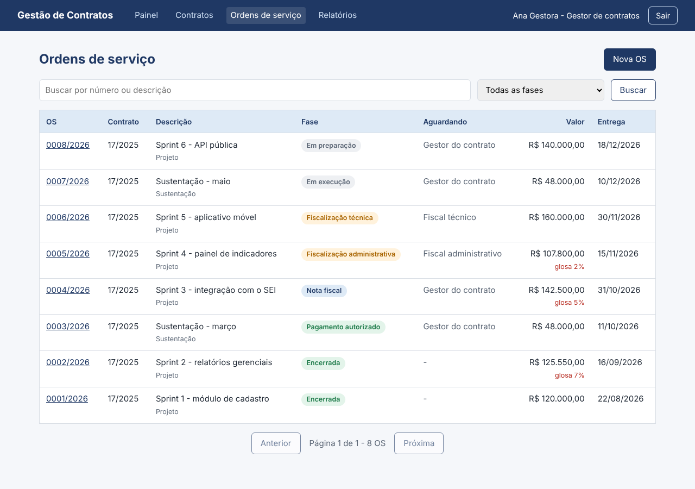
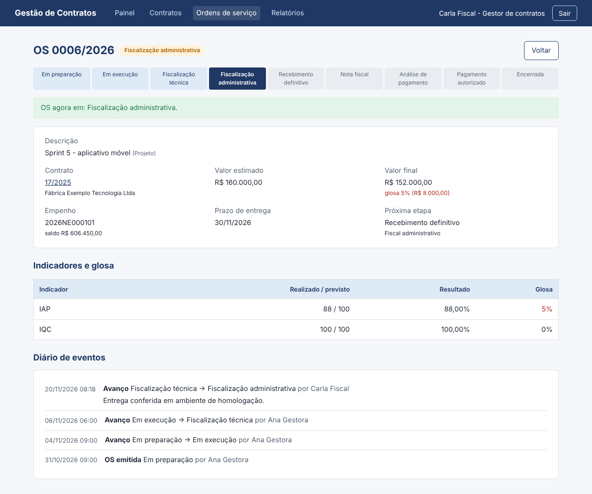
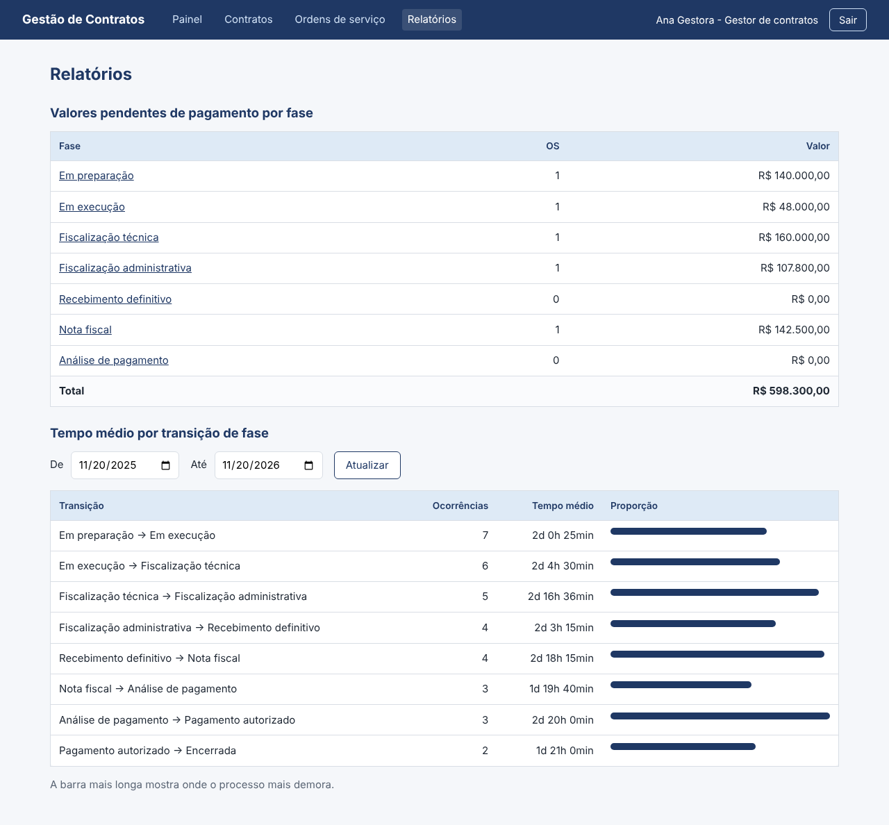
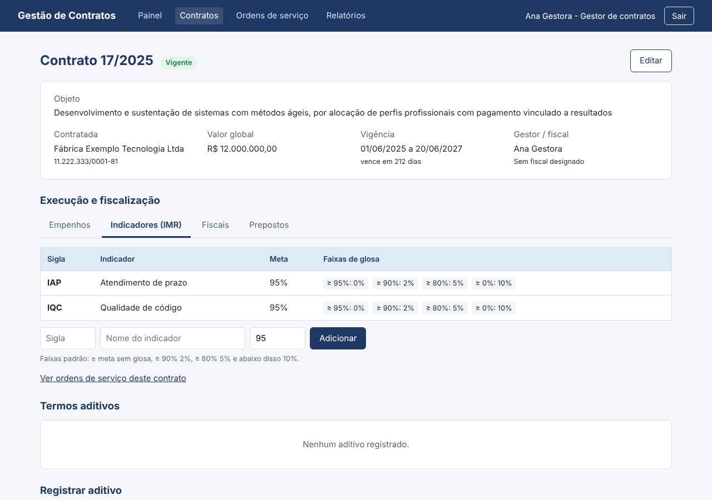
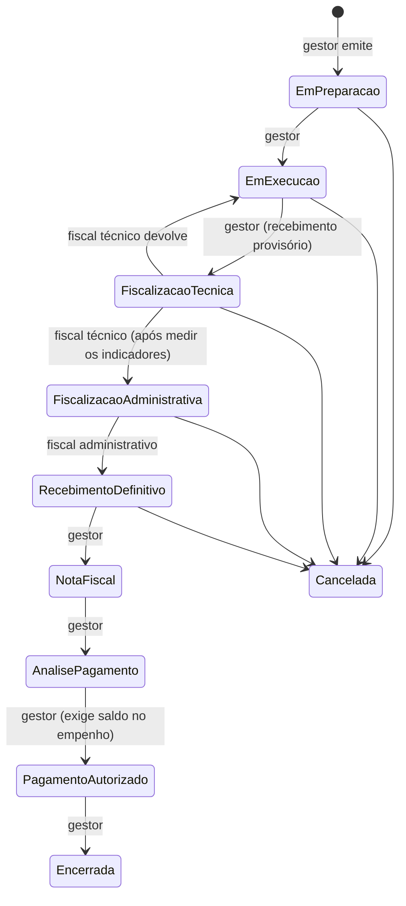
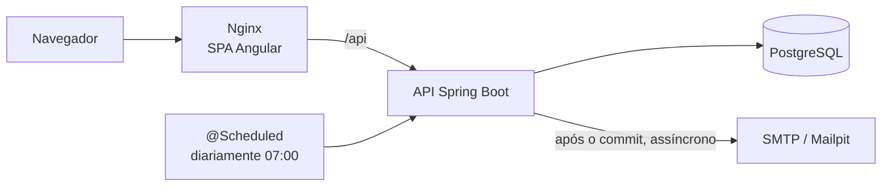

# Gestão de Contratos (Java)

Sistema web para a gestão e a fiscalização de contratos de TI no setor público: vigência e avisos de vencimento, ordens de serviço com fluxo de aprovação, glosas por indicadores de nível de serviço, empenhos e relatórios de desempenho do processo. A API é em **Java 21 com Spring Boot 3** e o front-end em **Angular 19**.

O projeto parte de problemas reais da fiscalização de contratos de fábrica de software. Já trabalhei com eles como fiscal técnica e no desenvolvimento em equipe de um sistema low-code em Oracle APEX. Aqui o domínio é reconstruído do zero, com código, testes automatizados e um front-end separado. Todos os dados são fictícios.

Existe também uma versão da mesma API em PHP/Laravel. As duas expõem exatamente o mesmo contrato JSON, e o front-end Angular é o mesmo nas duas.



## O que o sistema faz

### Contratos e vigência

- **Painel** com contratos a vencer em até 90 dias, vencidos e vigentes, além do valor total em vigor.
- **Cadastro de contratos** com validação de CNPJ pelos dígitos verificadores, no front-end e na API.
- **Termos aditivos** de prazo, de valor ou de ambos. O aditivo de prazo atualiza a vigência. O de valor soma ou subtrai do valor global, sempre com `BigDecimal`.
- **Avisos automáticos por e-mail** 90, 60 e 30 dias antes do vencimento, para o gestor e os fiscais do contrato.
- **Perfis de acesso**: administrador (tudo), gestor (cadastra e altera os contratos que gere) e consulta (somente leitura).

### Execução e fiscalização

- **Fiscais designados por portaria** (técnico, requisitante e administrativo, titular ou substituto, com vigência) e **prepostos** da contratada.
- **Notas de empenho** por contrato, com valor utilizado e saldo calculados a partir das OS pagas.
- **Indicadores de nível de serviço (IMR)** com meta e faixas de glosa.
- **Ordens de serviço** com numeração sequencial por ano e um fluxo de nove fases, da emissão ao encerramento. Cada fase só avança com o responsável certo: o gestor, o fiscal técnico ou o fiscal administrativo designados e em vigor.
- **Medição e glosa**: na fiscalização técnica, o fiscal informa o realizado e o previsto de cada indicador. O sistema calcula o resultado, aplica a faixa de glosa, respeita o teto de 30% e chega ao valor final da OS.
- **Devolução e cancelamento** com motivo obrigatório, e **diário de eventos** com cada mudança de fase, autor e observação.
- **Relatórios**: valores pendentes de pagamento por fase e tempo médio por transição de fase, para achar os gargalos do processo.







## Fluxo da ordem de serviço



## Arquitetura



| Camada | Tecnologias |
|---|---|
| API | Java 21, Spring Boot 3.3, Spring Web, Spring Data JPA (Hibernate), Spring Security, Flyway, springdoc-openapi (Swagger) |
| Banco | PostgreSQL 16, com as migrations versionadas no Flyway |
| Front-end | Angular 19 com componentes standalone, signals, Reactive Forms, interceptor HTTP e lazy loading |
| Infraestrutura | Docker Compose: Nginx, API, PostgreSQL e Mailpit |
| Qualidade | JUnit 5, AssertJ, MockMvc, Testcontainers, JaCoCo, Karma/Jasmine, GitHub Actions |

### Estrutura

```
backend/src/main/java/br/com/gestaocontratos/
  dominio/                    regras puras, sem framework
    FaseOrdemServico.java       fases, próxima fase e responsável por cada uma
    CalculadoraGlosa.java       resultado dos indicadores, faixas e teto de glosa
    RegrasVencimento.java       situação do contrato e marcos de aviso
    Cnpj.java                   validação de CNPJ
    modelo/                     entidades JPA (Contrato, OrdemServico, Empenho...)
  aplicacao/                  casos de uso, transações e permissões
    OrdemServicoService.java    fluxo da OS, medições e diário de eventos
    AditivoService.java         aditivos com trava do contrato
    AlertaVencimentoService.java  avisos idempotentes, uma transação por contrato
    RelatorioService.java       tempo médio por transição e valores pendentes
    PoliticaAcesso.java         permissões por perfil
    Validacao.java              erros de validação por campo (HTTP 422)
  repositorio/                Spring Data JPA e filtros (Specifications)
  seguranca/                  token Bearer, filtro, limite de tentativas de login
  web/                        controllers REST e tratamento de erros
  infraestrutura/             agendamento, e-mail, Swagger e dados de demonstração
backend/src/main/resources/db/migration/   esquema do banco (Flyway)
backend/src/test/java/                     testes de unidade e de integração
frontend/src/app/                          front-end Angular
```

## Decisões de projeto

- **Domínio sem framework.** Fases da OS, cálculo de glosa, vencimento e CNPJ são classes Java puras, testadas sem subir o Spring. As entidades JPA guardam o comportamento delas (`mudarFase`, `registrarMedicao`, `aplicarGlosa`), e os serviços de aplicação cuidam de transação, permissão e persistência.
- **Mesmo contrato de API da versão PHP.** O Jackson usa `snake_case`, as respostas vêm em `{"data": ...}`, a paginação em `meta.current_page`, e os erros de validação em `{"message", "errors": {"campo": [...]}}`. Por isso o mesmo front-end Angular funciona com as duas APIs.
- **Avisos sem duplicidade.** Cada envio fica registrado em `alertas_vencimento`, com chave única por contrato, marco e data de fim. Rodar a rotina duas vezes no mesmo dia não manda e-mail repetido, nem com várias instâncias da API.
- **Uma transação por contrato na rotina de avisos.** Um erro em um contrato não impede os demais. O e-mail sai depois do commit (`@TransactionalEventListener`) e fora da thread da rotina (`@Async`).
- **Novo ciclo após prorrogação.** Como a data de fim faz parte da chave, um aditivo de prazo inicia automaticamente um novo ciclo de avisos.
- **Marco aplicável, não exato.** O sistema envia o menor marco já alcançado. Um contrato cadastrado faltando 45 dias recebe o aviso de 60 dias, em vez de esperar até o de 30. Se o agendador ficar um dia parado, nenhum aviso se perde.
- **Situação calculada, não armazenada.** "Vigente", "A vencer" e "Vencido" saem da data de fim no momento da consulta, então nunca ficam desatualizados.
- **Fluxo como máquina de estados.** O enum `FaseOrdemServico` diz qual é a próxima fase e quem pode avançá-la. O serviço só aceita transições válidas, e a API devolve ao front-end as ações permitidas para o usuário, que mostra só os botões certos.
- **Permissão pela designação, não pelo perfil.** Quem mede e avança a fiscalização técnica é quem está designado como fiscal técnico daquele contrato, com a portaria em vigor. Uma designação encerrada perde o acesso na hora.
- **Dinheiro em `BigDecimal`.** As glosas de cada indicador são somadas, limitadas a 30% e aplicadas sobre o valor estimado com arredondamento ao centavo. Nenhum valor passa por `double`.
- **Concorrência tratada no banco.** Emitir OS e registrar aditivo travam a linha do contrato (`SELECT ... FOR UPDATE`), então duas operações simultâneas não geram o mesmo número.
- **Saldo de empenho derivado.** O saldo não é um campo editável: é o valor do empenho menos as OS com pagamento autorizado ou encerradas. O pagamento é bloqueado se o saldo não cobrir o valor final.
- **Token revogável.** O login gera um token aleatório. O banco guarda só o hash SHA-256, e o logout apaga o registro. Diferente de um JWT, o acesso termina na hora em que a pessoa sai. O token vale por 8 horas.
- **Tempo controlável.** Todas as datas vêm de um `Clock` injetado. Nos testes, um relógio de teste simula a passagem dos dias, por exemplo 90 dias de execução diária da rotina de avisos.
- **Exclusão lógica.** Contratos excluídos ficam no banco com `deleted_at` e somem das consultas (`@SQLRestriction`), preservando o histórico.

## Como executar

### Com Docker

```bash
docker compose up --build
```

- Sistema: http://localhost:8080
- Documentação da API (Swagger): http://localhost:8081/swagger-ui.html
- E-mails enviados (Mailpit): http://localhost:8025

A base é criada com usuários e contratos de demonstração. Todos usam a senha `password`.

| Perfil | E-mail | Papel na demonstração |
|---|---|---|
| Administrador | admin@exemplo.gov.br | pode tudo |
| Gestor | gestora@exemplo.gov.br | gestora do contrato 17/2025 (fábrica de software) |
| Gestor | fiscal@exemplo.gov.br | fiscal técnica do contrato 17/2025 |
| Gestor | fiscal.adm@exemplo.gov.br | fiscal administrativo do contrato 17/2025 |
| Consulta | consulta@exemplo.gov.br | somente leitura |

O contrato 17/2025 já vem com empenho, indicadores e oito OS em fases diferentes. Para ver o fluxo, entre como fiscal técnica, abra a OS em fiscalização técnica, registre as medições e avance.

### Sem Docker

Requisitos: Java 21, Maven, PostgreSQL 16 e Node 22.

```bash
# API (cria as tabelas pelo Flyway na primeira execução)
cd backend
DB_URL=jdbc:postgresql://localhost:5432/contratos DB_USERNAME=contratos DB_PASSWORD=contratos SEED_DEMO=true \
  mvn spring-boot:run              # http://localhost:8080

# Front-end (em outro terminal)
cd frontend
npm ci
npm start                          # http://localhost:4200
```

## API

Todas as rotas, exceto o login, exigem o cabeçalho `Authorization: Bearer <token>`. A documentação interativa fica em `/swagger-ui.html`.

| Método | Rota | Descrição |
|---|---|---|
| POST | `/api/login` | Autentica e devolve o token (limite de 5 tentativas por minuto) |
| POST | `/api/logout` | Revoga o token atual |
| GET | `/api/me` | Usuário autenticado |
| GET | `/api/painel` | Totais por situação e próximos vencimentos |
| GET | `/api/contratos` | Lista paginada; filtros `situacao`, `busca`, `gestor_id`, `page`, `por_pagina` |
| POST | `/api/contratos` | Cadastra contrato |
| GET | `/api/contratos/{id}` | Detalhe com aditivos, empenhos, indicadores, fiscais e prepostos |
| PUT | `/api/contratos/{id}` | Altera contrato |
| DELETE | `/api/contratos/{id}` | Exclui (exclusão lógica, só administrador) |
| POST | `/api/contratos/{id}/aditivos` | Registra termo aditivo |
| GET | `/api/usuarios` | Pessoas que podem ser gestoras ou fiscais |
| POST | `/api/contratos/{id}/empenhos` | Cadastra nota de empenho |
| POST | `/api/contratos/{id}/indicadores` | Cadastra indicador com faixas de glosa |
| POST | `/api/contratos/{id}/fiscais` | Designa fiscal |
| POST | `/api/contratos/{id}/prepostos` | Cadastra preposto |
| GET | `/api/ordens-servico` | Lista OS; filtros `fase`, `contrato_id`, `busca` |
| POST | `/api/ordens-servico` | Emite OS |
| GET | `/api/ordens-servico/{id}` | Detalhe com medições, diário e ações permitidas |
| PUT | `/api/ordens-servico/{id}/medicoes` | Registra medições e recalcula a glosa |
| POST | `/api/ordens-servico/{id}/avancar` | Avança para a próxima fase |
| POST | `/api/ordens-servico/{id}/devolver` | Devolve para correção (fiscal técnico) |
| POST | `/api/ordens-servico/{id}/cancelar` | Cancela com motivo (até o recebimento definitivo) |
| PUT | `/api/ordens-servico/{id}/empenho` | Vincula nota de empenho |
| GET | `/api/relatorios/tempo-medio` | Tempo médio por transição de fase (`inicio`, `fim`) |
| GET | `/api/relatorios/valores-pendentes` | Valores a pagar por fase |

## Testes

```bash
cd backend && mvn verify              # 87 casos: 41 de unidade e 46 de integração (precisa de Docker)
cd frontend && npm run test:ci        # 13 testes
```

- **Unidade** (`*Test`): CNPJ, faixas e teto de glosa, arredondamento ao centavo, situação e marcos de vencimento, fluxo de fases, formatação em português, validação e texto do e-mail.
- **Integração** (`*IT`): sobem a aplicação inteira contra um PostgreSQL real com Testcontainers e chamam a API pelo MockMvc. Cobrem login, expiração e revogação do token, limite de tentativas, permissões por perfil, aditivos, cadastros, o fluxo completo da OS até o encerramento, glosas, bloqueio por falta de saldo no empenho, relatórios e a rotina de avisos. Um dos testes simula 90 dias de execução diária e confere que chegam exatamente os avisos de 90, 60 e 30 dias.

No GitHub Actions, `mvn verify` roda os dois tipos de teste e gera o relatório de cobertura do JaCoCo.

## Autora

Christiellen Okubo - [LinkedIn](https://www.linkedin.com/in/christiellen-okubo-30b15b2a0/) - [GitHub](https://github.com/Christiellen)
